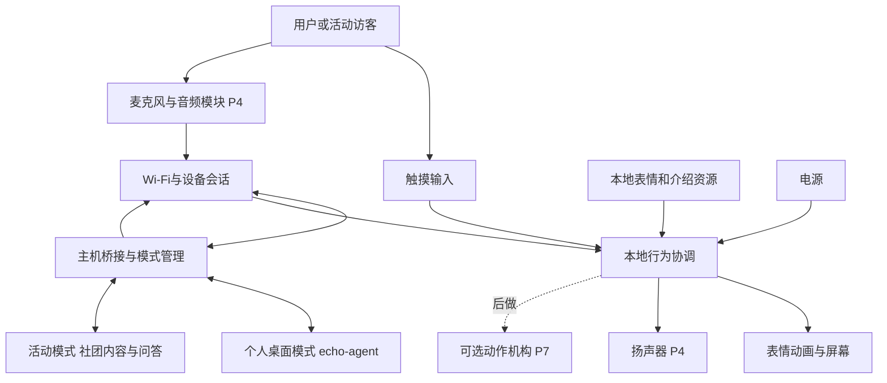

# BuilderSpace 吉祥物：完整版功能蓝图

版本：产品蓝图 1.0，2026-11-17（悉尼）。这是用户确认的完整方向及建议实施路线，不是完成情况声明。进度以 STATUS 为准。

## 1. 用户确认的愿景

它首先是 BuilderSpace 社团的实体吉祥物：有自己的外形和屏幕表情，摸它会回应，能和人说话。平时放在桌上，通过无线连接 echo-agent 帮用户做事；活动时可以带出去展示、互动和介绍社团。第一阶段先完成屏幕表情。

名字、性格、软硬材质、身体尺寸和运动机构尚未确定，不把建议当作用户已确认的设计。原 K151 规划是参考路线，不是当前必须购买的硬件。

## 2. 三个使用层次

| 层次 | 使用体验 | 所依赖的资源 |
| --- | --- | --- |
| 本体互动 | 开机有脸、眨眼、摸头回应、播放已准备的介绍 | 本地固件、素材、触摸；播报阶段另需音频硬件 |
| 桌面伙伴 | 看见 echo 工作状态，后续可说话发起任务和听回复 | 电脑/主机在线、echo 与桥接服务可用 |
| 活动接待 | 独立社团介绍、FAQ、项目讲解、二维码引导；有网时开放问答 | 社团审核的内容包；在线问答另需主机与网络 |

活动首个可交付版本按携带社团电脑作为主机、优先实测手机热点供网络规划；离线仍有本地表情、触摸和准备好的介绍。手机热点只提供网络，不自动成为 AI 主机。“只带玩偶也能联网自由交流”是后续主机部署决策，尚未承诺。

## 3. 功能全景

| 模块 | 完整版功能 | 首次交付阶段 | 后续扩展 |
| --- | --- | --- | --- |
| 社团角色 | 名字、性格、外形、用语、视觉规范 | P1 同步设计，P5 成型 | 服饰、节日主题、可换装 |
| 屏幕表情 | 眼睛/嘴巴、眨眼、视线、七态、自然过渡 | P1 | 说话口型、主题和更多情绪 |
| 触摸互动 | 摸头回应、轻拍唤醒、互动冷却 | P2 | 分区触摸、组合互动 |
| 行为协调 | 任务、对话、触摸和空闲动作的仲裁 | P2 | 多种活动脚本与行为组合 |
| 无线与配置 | 配网、重连、设备身份、诊断 | P3 | OTA、更多设备和连接方式 |
| echo 桌面协作 | 真实状态显示，语音阶段发起任务和反馈 | P3 状态；P4 语音 | 按明确接口扩展详细反馈 |
| 语音系统 | 麦克风输入、语音识别、回答、扬声器播放、静音 | P4 | 选配唤醒词、打断、声学优化 |
| 活动内容 | 自我介绍、社团介绍、项目/FAQ、加入方式 | P5；内容可从 P1 准备 | 多语言、按活动切换主题 |
| 模式管理 | 演示、个人桌面、活动接待；管理员切换 | P3 起逐步实现 | 活动配置包和维护工具 |
| 外壳结构 | 屏幕面部、可触摸区域、固定件、可维修装配 | P1 草图；P5 样机 | 软外套、可替换件 |
| 供电携带 | 桌面供电、活动移动供电、运输保护 | P1 桌面；P5 携带 | 集成电池需独立设计与实测 |
| 身体动作 | 可选点头/歪头等 | P7，后做 | 双轴动作、状态联动 |
| 测试维护 | 配置、更新、恢复、故障记录、成员交接 | 各阶段；P6 完整交付 | 小批量装配与备件管理 |

灯带为可选装饰，已有材料可复用，不占用第一阶段主线。摄像头、移动行走、成员人脸识别不在目前确认的功能范围中。

## 4. 整体架构

图中的所有模块是规划。AI、识别、TTS 与任务执行优先放在主机侧，设备侧保留交互、绘制、采音/播放与离线脚本。P1 直接使用带 PSRAM 的 ESP32-S3，现有 C3 留作灯带实验。P4 前评审同一 S3 的资源与音频 GPIO；若仍需更换板型，复用表情参数、状态语义和内容，不假定固件二进制通用。

## 5. 两个关键体验闭环

### 桌面闭环

触发说话 → 录音指示 → 主机理解/处理 → echo 执行任务 → 屏幕反馈状态 → 如需审批，在电脑查看并处理 → 简短结果反馈。前期先由电脑麦克风与扬声器承担声音，再换成机身硬件。

### 活动闭环

成员设置活动模式 → 访客摸头/按互动入口 → 吉祥物回应 → 介绍社团或回答已审核 FAQ → 引导查看展示牌/二维码 → 回到安静待机。初期离线使用固定介绍和问答选项，有网后再增加自由问答。

活动模式不连接个人任务权限，不读取个人对话与文件，不允许访客通过玩偶执行个人电脑命令。模式切换由管理员明确操作；桌面后台结果不覆盖活动接待。活动内容由社团成员审核，未知信息不编造。

## 6. 功能先后与决策

执行顺序：P1 屏幕 → P2 触摸 → P3 无线/echo 状态 → P4 语音 → P5 活动样机 → P6 展示稳定与交接。P7 动作/进一步独立运行按需开启。

允许提前并行：社团角色草图、介绍稿、外壳概念、echo 接口可行性验证。不能把它们变成 P1 的前置阻塞。

重要决策门：

1. P1 后确认屏幕的实际大小是否符合外形，再决定最终壳体。
2. P3 验证真实 echo；手动演示不能替代。主机新接口不可用时保留已完成的本地吉祥物功能，记录缺口。
3. P4 采购前冻结主控、音频、GPIO、供电和驱动兼容方案，集成板与分立模块二选一，避免重复购买。
4. P5 前由用户/社团确认角色形象、软硬材质、内容和活动现场主机安排。
5. P6 实测后再定续航和复制数量，不提前承诺独立运行时长或批量成本。

## 7. 待决策清单

角色名字/性格；硬壳、软体还是组合；脸部屏幕尺寸；活动所需语言；活动是否带主机；预算与展示日期；是否需要身体动作。以上均允许在 P1 期间逐项讨论，当前不阻止表情开发。
