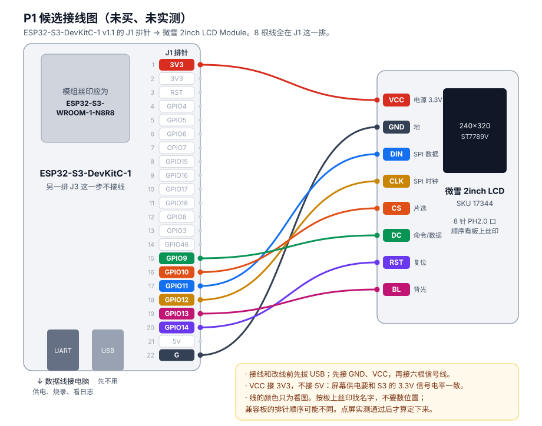

# 分阶段实现与验收

完整版阶段编号采用 P1–P7。旧 M0–M4 只描述早期屏幕/无线链路，不再代表整个产品。每阶段完成定义均包含交接材料与真实测试证据。

## P1：屏幕表情，现在先做

目标：真实 S3 屏幕有一张会眨眼、移动视线、切换表情的脸。

执行：T0 建 ESP32-S3 工程与公共接口；T1 做电脑预览和表情参数；T2 核对板子/采购一块屏幕并出接线表；T3 点屏与方向色序；T4 移植表情。先用几何图形，局部刷新，网络缺失不影响动画。采用临时支架，不等最终外壳。

顺序：视觉预览 → 硬件确认 → 红绿蓝测试 → 画脸 → 眨眼/视线 → 七态/过渡 → 自动演示。电脑键盘或本地演示脚本切表情即可。

交付：预览、可重复构建/刷写的源码与固件、引脚表、实物视频、表情参数、恢复说明。验收：自动启动；所有表情可区分；断网仍眨眼；连续运行 30 分钟无重启/花屏；记录实际帧率，不将目标 15–25fps 写成实测。

依赖/采购：现有面包板，加一块带 PSRAM 的 S3、屏幕和缺少的线材。C3 留作灯带实验。人工负责接线、烧录、录像，agent 负责代码与步骤。

### P1 硬件到货后的使用步骤（2026-11-19 补充，全部待实测）

前提是假设：已买到 ESP32-S3-DevKitC-1-N8R8 和微雪 2inch LCD Module（SKU 17344）。两样都尚未购买，下面没有任何一步在实物上做过。买到的若是兼容板或其他屏幕，引脚和 USB 口先按实物重新核对。规格依据是 PURCHASES 里链接的两份官方文档（2026-11-19 重新读过）。

**第 0 步：下单前的准备（不需要硬件）**

- 接线图：P1 只有 8 根线，一张接线图就够，不需要原理图或 PCB。原理图等 P5 把面包板换成洞洞板、或 P7 做定制 PCB 时再画。
- 开发环境：已就绪，见第 2 步第 1 条。
- 点屏测试固件和画脸固件可以先写、先编译通过，到货后直接烧；没有实物时只能证明能编译，不能证明能点亮。画脸固件要等用户在预览里选定表情并导出参数。
- 清点手头的东西：USB 数据线的接口和能否传数据、电脑有什么 USB 口、杜邦线是公头还是母头。
- 用预览页的“实际大小”或一张 40.8×30.6mm 的纸片，先看脸在这块屏上够不够大，再决定买不买这个尺寸。

**第 1 步：开箱核对（人工，不通电）**

- 看模组金属壳上的丝印，确认是 `ESP32-S3-WROOM-1-N8R8`。N8 没有 PSRAM，N8R2 只有 2MB，都不是要买的型号。
- 看 USB 口：官方板有两个 Micro-USB 口，一个标 UART，一个标 USB；兼容板常见 USB-C。数据线必须能传数据，只能充电的线烧不了程序。
- 看排针是否已焊好；没焊就先焊，否则插不了面包板。
- 屏幕背面丝印应有 VCC、GND、DIN、CLK、CS、DC、RST、BL 八个引脚，并核对随附的 8 针线。
- 拍板子正反面、模组丝印、屏幕背面，照片放 `local/`。

**第 2 步：只接 USB，先验板子（不接屏幕）**

1. 开发环境：本机已有 ESP-IDF v5.4.1（`~/esp/esp-idf`，工具在 `~/.espressif`）。2026-11-19 用它把官方 hello_world 对 `esp32s3` 目标、打开 Octal PSRAM 和 8MB Flash 编译通过（在临时目录里做的，没有烧录）。每开一个新终端先运行 `. ~/esp/esp-idf/export.sh`，之后才有 `idf.py`。换电脑则按乐鑫官方 Get Started 重新安装。
2. 数据线接板子标 UART 的口。插拔前后各运行一次 `ls /dev/cu.*`，多出来的那个就是串口。
3. 在示例工程里设目标并烧录，下面的端口名换成上一步看到的：

```sh
idf.py set-target esp32s3
idf.py -p /dev/cu.usbserial-XXXX flash monitor
```

4. 烧不进去时：按住 BOOT，点一下 RESET，再松开 BOOT，进入下载模式后重试。
5. 在 `idf.py menuconfig` 里打开 PSRAM 支持并选 Octal 模式，重新烧录后启动日志应报出约 8MB PSRAM。报不出来先查型号后缀，不要继续接屏。

通过标准：串口有启动日志、能重复烧录、PSRAM 被识别。

**第 3 步：断电接线**

候选接线如下，只是点屏的起点，A4 实测通过后才写成唯一 GPIO 表。图见 [p1-wiring.svg](p1-wiring.svg)：



按官方 v1.1 板的排针表（2026-11-19 核对），这 8 根线全在 J1 一排：3V3 是第 1 脚，GPIO9–14 是第 15–20 脚，G 是第 22 脚。兼容板的排列可能不同，按丝印上的名字找。

| 屏幕引脚 | 接 S3 | 说明 |
| --- | --- | --- |
| VCC | 3V3 | 屏幕支持 3.3V/5V；接 3.3V 与 S3 的逻辑电平一致 |
| GND | G | 共地 |
| DIN | GPIO11 | SPI 数据（MOSI） |
| CLK | GPIO12 | SPI 时钟 |
| CS | GPIO10 | 片选，低有效 |
| DC | GPIO9 | 低为命令，高为数据 |
| RST | GPIO14 | 复位，低有效 |
| BL | GPIO13 | 背光；先直接拉高常亮，调光后做 |

选 GPIO9–14 的理由：10/11/12 是 S3 第二路硬件 SPI 的默认引脚；GPIO1–8 的触摸通道留给 P2 摸头；其余空闲引脚留给 P4 音频。

不要占用的引脚：GPIO0、3、45、46（启动配置脚）；GPIO19、20（USB）；GPIO43、44（串口日志）；GPIO35、36、37（带 8MB Octal PSRAM 的模组内部占用，以模组规格书为准）；GPIO38 或 48（板载 RGB 灯，随板子版本不同）。

接线时拔掉 USB。先接 GND 和 VCC，再接信号线，通电前对照表格逐根复查。屏幕工作电流约 46mA，由板子 3V3 引脚供电即可。

**第 4 步：点屏测试（A4）**

用 ESP-IDF 自带的 ST7789 面板驱动（`esp_lcd` 组件），SPI 模式 0，依次验证：

1. 背光亮，全屏纯红、纯绿、纯蓝各停几秒。红蓝对调说明色序要改；颜色像底片说明要开或关反色。
2. 画四角标记和一个箭头，确认横向 320×240 的方向和镜像正确，画面没有偏移或花边。
3. 记录能稳定工作的 SPI 频率，先低后高。

通过标准：三色正确、方向正确、无花屏；色序、反色、旋转、频率四个结果写进板级配置。每项拍照。

**第 5 步：画脸（A5）**

等工作包 B 交出用户确认过的视觉参数包后再做。顺序：静态脸 → 眨眼和视线 → 七态过渡 → 自动轮播演示。采用局部刷新，记录实测帧率和内存占用。视觉未确认前可以先用临时几何脸打通绘制流程，但不当作定稿。

**第 6 步：P1 验收（A6）**

只接 USB 电源、不连电脑也能自动开机显示；不连 Wi-Fi 仍眨眼；连续运行 30 分钟无重启、无花屏。记录固件提交号、供电方式、屏幕和板子型号。

**分工**：持实物的人负责开箱核对、接线、按键、拍照录像；agent 负责工程代码、配置、烧录命令和排错步骤。agent 看不到实物，屏幕上显示了什么以照片和视频为准。

## P2：触摸与角色反应，接着做

目标：摸它会有回应，形成初步角色感。

执行：T9 在头部候选位置优先用 S3 原生触摸加电极（不稳再评估 3.3V 外置模块），先以“触摸一次 → 开心一下 → 回待机”为闭环；加入去抖、冷却和长触摸后的释放处理。T10 统一动作脚本与优先级。暂用可更换电极验证材质，不把触摸屏当摸头传感器。

交付：触摸接线、电极位置、事件接口、行为参数、材质测试记录。验收目标：20 次触摸至少 18 次正确识别；连续触摸不无限重复触发；空闲 10 分钟无误触；断网仍响应。声音阶段未开始时用表情回应即可。摸头不审批、不启动任意电脑任务。

## P3：无线与桌面 echo 状态

目标：玩偶无线跟随真实 echo 任务，同时保留本地互动。

执行：T5 实现配网、快照、超时和重连；T6 交付 demo 控制页，再验证 PTY / ECHO_DEVICE_PORT 与真实 App 的握手。T10 处理触摸、任务和空闲的协调；T14 建模式入口。先用单台设备、同一局域网和配置好的主机地址。

交付：服务启动说明、设备配置、模式标记、真实 App 版本、原始状态与屏幕变化的对应记录。验收：手动演示七态；真实任务工作/待确认/成功/失败有证据；5 次断网恢复；电脑服务停止与 echo 上游停止均正确离线；恢复不重放旧互动。获取不到真实状态时只验收 demo，列明真实接入阻塞。

## P4：语音互动与帮忙做事

目标：能和它说话，它能回答；个人模式可通过 echo 发起授权范围内的任务。

实现顺序：

1. T11 先在电脑端完成“输入声音 → 识别 → 简短回答 → 播放”，核验 echo 已发布接口是否支持所需音频入口/结果；缺少音频回传时单独设计主机 TTS 适配，不当作已有能力。
2. T2/T11 冻结最终硬件方案：核查当前 S3 的引脚、驱动、内存、功放、供电与屏幕兼容性，不预设第二次购主控。现有 C3 保留为灯带实验板。
3. 机身先实现播放固定声音，再实现按住一个明确入口录音、松开发送，最后接入对话。使用半双工：录音时停止播放；本阶段先不要求唤醒词/全双工。
4. T10 将听取/思考/说话/结果与表情协调，嘴巴先用简单说话动画；T14 设置静音、音量和录音指示。

交付：音频 BOM、资源与 GPIO 表、声音链路说明、固定测试指令、可复现代码、接口缺口。验收目标：安静桌面 20 次预设对话至少 18 次完成正确闭环；失败可见、可重试；10 次取消/停止无残留播放；触摸不误发语音。必须分别记录识别、模型、echo 任务与播放失败，不能只报总成功率。

## P5：活动接待与完整外形

目标：可以带到社团展台，互动并介绍 BuilderSpace。

执行：T12 与社团成员编写并审核自我介绍、30 秒/90 秒社团介绍、至少 10 条 FAQ、项目介绍和加入指引；T13 输出正式角色与外观；T7 制作可维修外壳；T14 做管理员模式切换，活动模式隔离个人工具。T15 评估外部 USB 移动电源、线缆和运输方案；暂不自行集成裸锂电系统。

活动保底采用明确按键或菜单选择＋预录介绍；自由语音问答属于增强项，可按 O-Week 工期延期。现场按两个层次交付：无网可表情/触摸/播放预置介绍（本地存储需 P4 音频支持）；有网且活动主机在线可做社团问答。首次活动默认可携带社团电脑或使用已部署的主机；只带玩偶的自由问答尚需额外决策。

验收：5 次触摸/入口启动介绍；离线介绍完整播放；活动模式无法进入个人任务；5 条未知问题不编造社团事实；二维码实际扫码可用；外壳能拆装和访问维护接口。小屏二维码若不易识别，使用旁边的实体展示牌。

## P6：稳定、维护与正式交接

目标：社团其他成员能独立开机、展示、排错与收纳。

执行：T8/T15 测量功耗、发热、线缆固定、移动电源是否低负载关断和实际运行时间；测试断网、重启、主机退出、模式切换、版本升级与回退。整理一页开机卡、接线/装配图、BOM、配置方法、固件版本和故障手册。

验收目标：先完成 2 小时桌面/活动综合运行；再按确定的活动时长做满时长测试；5 次关机重启和网络恢复；至少一名未参与开发的成员按说明成功完成开机、切活动模式、播放介绍和恢复连接。续航标注为实测条件下结果，不用电池标称容量换算作承诺。

## P7：选配升级，基础版稳定后再做

- 身体动作：先一轴、再评估两轴；独立验证电源、校准、限幅、夹手/线缆/倾倒风险；录音时静止；需要用户确认是否加入。
- 集成电池：完整充电/保护/电源路径与开关设计，先确定峰值功耗和外壳空间。
- 更独立的使用：选择活动独立服务器/云主机或本地计算平台；定义无电脑时哪些功能仍可用与服务费用。
- 其他可选：唤醒词、蓝牙配网、OTA、主题包、多台设备与小批量。

上述不是完整版基础交付的前置条件；每项开启时单独列 BOM、接口和验收。

## 并行安排与依赖

第一批：T0 总集成＋T1 表情＋T2 硬件确认；T6 可提前调查 echo 接入；T12/T13 可准备内容和角色草图。

第二批：T3 屏幕驱动、T4 表情移植完成 P1；随后 T9/T10 做 P2；T5/T6 做 P3。不要让语音、最终壳体或社团文案阻塞屏幕点亮。

第三批：P4 音频评审与实现；T12/T13/T7 并行推进 P5；T14/T15 完成模式与携带；T8 做整机验证。

目标为 O-Week 展示，建议倒排见 NEXT_STEPS。具体社团出场日、负责人和预算待确认；按到货、实测与人力调整，不套用旧 K151 工期。
